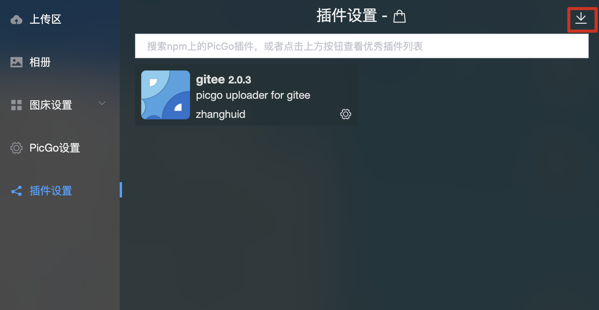
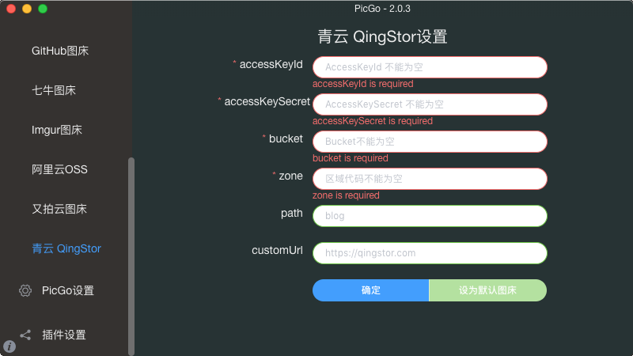

## picgo-plugin-qingstor-uploader

[English](./README.md) | 简体中文

为 [PicGo](https://github.com/Molunerfinn/PicGo) 开发的一款插件，新增了[青云 QingStor](https://www.qingcloud.com/products/objectstorage/) 图床。

### 安装

- 在线安装

    打开 [PicGo](https://github.com/Molunerfinn/PicGo) 详细窗口，选择**插件设置**，搜索**qingstor-uploader**安装，然后重启应用即可。

- 离线安装

    1. 克隆该项目
    2. 打开 [PicGo](https://github.com/Molunerfinn/PicGo) 详细窗口，选择**插件设置**，并点击如下按钮：
       
    3. 选择你克隆仓库的文件夹
    4. 重启应用即可

### 截图

### 配置

|参数名称|类型|描述|是否必须|
|:--:|:--:|:--:|:--:|
|accessKeyId|input|AccessKeyId，在青云控制台「API 密钥」页面创建并获取|true|
|accessKeySecret|password|与 AccessKeyId 配对使用，请妥善保管，不要泄露|true|
|bucket|input|Bucket 名称，需要提前创建，名称只支持小写字母、数字和中划线（-）|true|
|zone|input|区域代码，例如 `pek3b`。青云公有云常见区域：`pek3a`、`pek3b`、`sh1a`、`gd2`；私有云或其他区域请直接填写实际值|true|
|path|input|上传时默认存储路径，留空表示根目录|false|
|endpoint|input|对象存储域名，默认 `https://qingstor.com`，也可用 `https://qsstor.com`；私有云可填写自定义地址|true|
|deleteRemote|confirm|删除相册图片时，同步删除对象存储中的对象|false|

在 PicGo 客户端里，每个配置项都带有本地化的标题与提示（简体中文 / 繁體中文 / English / 日本語 / 한국어）。可以在插件菜单里点击「检查配置与连接」来校验配置并测试连通性。

默认使用青云官方 Endpoint：`https://<bucket>.<zone>.qingstor.com`（`https://qingstor.com`）。也支持 `https://qsstor.com`；私有云请把「对象存储域名」填成自己的地址。

### 同步删除

在插件设置里打开 **「同步删除云端对象」** 开关后，从 PicGo 相册删除青云 QingStor 的图片时，会同时对对象存储发起 `DELETE` 删除对应对象，并用通知反馈结果。开关默认关闭，此时只删除相册记录。对象 key 由图片地址反推，即使之后修改了存储路径也能删对。

