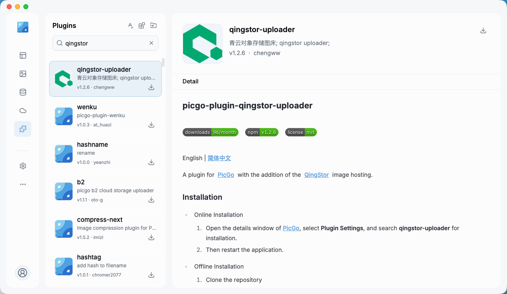
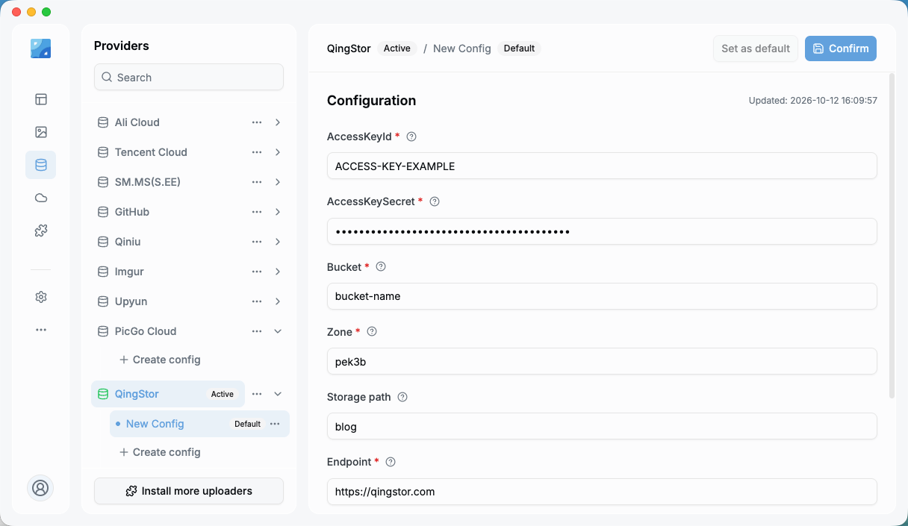

## picgo-plugin-qingstor-uploader

English | [简体中文](./README-zh_CN.md)

A [PicGo](https://github.com/Molunerfinn/PicGo) uploader plugin for [QingStor](https://www.qingcloud.com/products/objectstorage/), QingCloud's object storage: upload images to your bucket and get the download URL.

### Features

- Upload images to a QingStor bucket.
- Localized config form and notifications: zh-CN / zh-TW / en / ja / ko.
- **Check config & connection** in the plugin menu, to validate the config and test reachability.
- Optional **sync delete**: deleting an image from the PicGo album also deletes the matching object.

### Installation

1. Open PicGo, go to **Plugin Settings** and search **qingstor**.

   

2. Install it and restart PicGo.

### Screenshots

### Configuration

|Key|Type|Description|Required|
|:--:|:--:|:--:|:--:|
|accessKeyId|input|QingCloud API key ID. Create and copy it from the console's **API Keys** page|yes|
|accessKeySecret|password|Paired with AccessKeyId. Keep it secret|yes|
|bucket|input|Bucket name. Create it in the QingCloud console first. Only lowercase letters, digits and hyphens (-) are allowed|yes|
|zone|input|Zone id, e.g. `pek3b`. Common zones: `pek3a`, `pek3b`, `sh1a`, `gd2`. For private cloud or other regions, enter the actual value|yes|
|path|input|Path inside the bucket to store files under. Leave empty for the bucket root|no|
|endpoint|input|Endpoint domain. Default `https://qingstor.com`; `https://qsstor.com` is also supported; for private cloud, enter your own address|yes|
|deleteRemote|confirm|When on, deleting an image from the PicGo album also deletes the object from QingStor|no|

The config form is localized (zh-CN / zh-TW / en / ja / ko); the table above lists the config keys. The generated object URL looks like `https://<bucket>.<zone>.<endpoint>`, by default `https://<bucket>.<zone>.qingstor.com`. Click **Check config & connection** in the plugin menu to validate the config and test connectivity.

### Sync delete

Turn on **Sync delete objects** (`deleteRemote`) in the plugin settings to also delete the matching object whenever you remove an image from the PicGo album. The result is reported with a notification: a single delete shows the file name, multiple deletes show the total. When the switch is off (the default), removing an image only removes the album entry. The object key is derived from the image URL, so it keeps working even after you change `path`.

### License

[MIT](./License)
